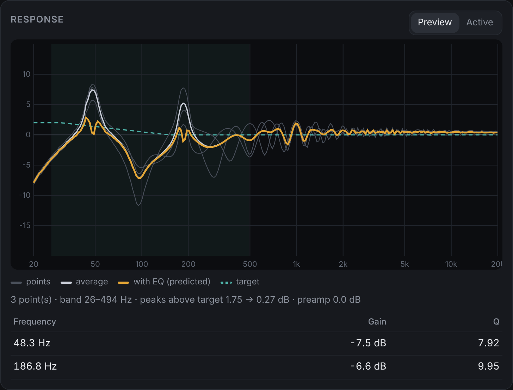

# kodi-roomeq

Automatic low-frequency room correction for Kodi on LibreELEC, run from a phone browser.

Plug a mic into your USB audio interface. Tap **Measure point** at a few spots around the couch, check the curves, then tap **Apply**. Kodi then plays through a parametric EQ that tames the room's bass modes. A single switch takes it out of the signal path again.

[Русская версия](README.ru.md)



## What it does

- **Measures** with an 8 s exponential sine sweep. The response comes from deconvolving the recording, so latency does not matter and most background noise is rejected. Each recording is checked first: clipping, a too-quiet mic, or low SNR is rejected with a clear message.
- **Averages several listening positions.** Every point is normalised to its own 200-2000 Hz level, then the points are power-averaged. Filters that fix one exact spot and make the rest of the sofa worse are avoided.
- **Fits up to 8 peaking filters** below 500 Hz to reach a target with a gentle bass shelf. The fit is conservative by design:
  - it cuts peaks, which is what modes need, and mostly leaves dips alone, because a null cannot be filled with power;
  - boosts are capped (3 dB by default), never narrow, and never below a set frequency (150 Hz by default). It never pumps a speaker's natural roll-off.
- **Applies the filters** in a 4 KB LADSPA plugin, inserted into ALSA as a separate output device. Kodi sees two outputs, `roomeq` and `roomeq_direct`. Switching between them is instant and never touches the filters.
- **Web UI** at `http://<kodi>:8080/addons/webinterface.roomeq/`, in English and Russian. It has the per-point curves, a preview of the predicted result before applying, the filter table and the settings.
- **Low footprint.** Analysis takes about 5 s per point on a Raspberry Pi 3. Playback costs a few biquads per channel. The code is plain C99 with no dependencies beyond libc and libm.

## Requirements

- LibreELEC 10-12 (Kodi 19-21), on 32-bit ARM or aarch64. Other Linux boxes work too: build with `make` and set the paths through environment variables (see `scripts/roomeq.sh`).
- A USB audio interface with at least one input and one output. Developed on a Behringer UMC204HD; any class-compliant card should work.
- A mic. A measurement mic is best (Behringer ECM8000, Dayton EMM-6, or similar on +48 V). A dynamic vocal mic also works if the boost floor stays at 150 Hz, because below that its own roll-off would be "corrected".
- Kodi web server on: *Settings → Services → Control → Allow remote control via HTTP*, no password.

## Install

Download `kodi-roomeq-1.0.0.tar.gz` from [Releases](https://github.com/NeuralF/kodi-roomeq/releases). It contains prebuilt binaries for armhf and aarch64.

```sh
# on your computer
scp kodi-roomeq-1.0.0.tar.gz root@<kodi>:/storage/
# on the box
ssh root@<kodi>
cd /storage && tar xzf kodi-roomeq-1.0.0.tar.gz && sh kodi-roomeq-1.0.0/scripts/install.sh
systemctl restart kodi
```

Then open `http://<kodi>:8080/addons/webinterface.roomeq/`.

- If your mic is not on input 1, set **Mic input channel** under *Settings*.
- Uninstall with `sh scripts/install.sh uninstall`. Measurements in `/storage/.config/roomeq` are kept.

## Measuring well

1. Set the volume to a normal, loud-ish listening level. The sweep plays at −10 dBFS.
2. Put the mic at ear height, pointing at the ceiling. Use a stand rather than a hand: handling noise wrecks the low end.
3. Take 3-5 points, 30-50 cm apart, around where heads actually are. Bad points can be removed with **Undo last**.
4. Look at the preview:
   - The grey lines are your points and the white line is their average.
   - The orange line is the predicted result and the dashed green line is the target.
   - If the points disagree wildly at a frequency, the room is position-dependent there. The averaged fit will leave that frequency mostly alone, which is the right call.
5. Tap **Apply**, listen, and toggle the switch to compare.

## Command line

```sh
/storage/roomeq/roomeq.sh on|off|new|measure|undo|apply|reset|status
/storage/roomeq/roomeq-tool gen sweep.wav 2
/storage/roomeq/roomeq-tool check rec.wav 2
/storage/roomeq/roomeq-tool analyze outdir 2 p1.wav p2.wav p3.wav
```

- `roomeq-tool` works on any 48 kHz recording of its own sweep, so you can also record in a DAW and analyse on a desktop.
- The filter file format is plain text, one filter per line: `preamp <dB>` and `pk <Hz> <dB> <Q>`. You can write it by hand.

The analyser can be tuned through `/storage/.config/roomeq/roomeq.conf` or the web settings:

| key | default | meaning |
|---|---|---|
| `MIC_CH` | 1 | input channel of the mic |
| `CARD` | auto | ALSA card id; auto picks the first USB card with an input |
| `FORMAT` | S32_LE | sample format forced on the card (see [notes](docs/notes.md)) |
| `RQ_FMAX` | 500 | correct up to this frequency, Hz |
| `RQ_BASS` | 2 | target bass lift, dB: a slope from 0 at 150 Hz up to the full value at 30 Hz |
| `RQ_MAXF` | 8 | maximum number of filters |
| `RQ_MAXBOOST` | 3 | maximum boost, dB (0 = cut only) |
| `RQ_BOOST_FMIN` | 150 | no boost below this frequency, Hz |
| `RQ_MIC_CAL` | none | mic calibration file (`Hz dB` per line; REW and miniDSP UMIK files work as is) |

## Build from source

```sh
make            # native build into build/native
make test       # synthetic 3-point room: checks the fit, boost limits and the biquad math
make cross      # armhf + aarch64 via zig (pip install ziglang), glibc 2.28 baseline
make dist       # release tarball
```

## How it hooks into Kodi

`roomeq.sh setup` writes the following into `/storage/.config/asound.conf`:

```
roomeq        → plug → ladspa(roomeq_mono, per channel) → lfloat → hw (S32_LE)
roomeq_direct → plug → hw (S32_LE)
```

Kodi opens ALSA devices without automatic format conversion, which is why the float plugin chain looks the way it does. Details, and the quirks of the UMC204HD, are in [docs/notes.md](docs/notes.md).

## License

MIT
